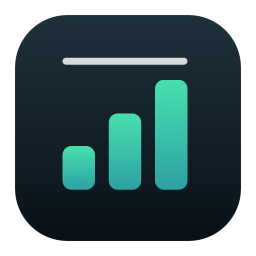
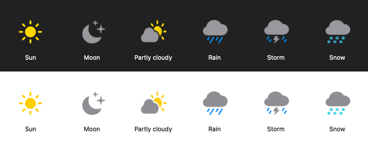

# BarLuma

**Your Mac, at a glance.**

Network speed, CPU, memory and local weather — quietly in your menu bar.

[**Download for macOS ↓**](https://github.com/AbdullahNazih/BarLuma/releases/download/v1.1.1-preview.1/BarLuma-1.1.1-preview.pkg) · [All releases](https://github.com/AbdullahNazih/BarLuma/releases) · [User guide](docs/USER_GUIDE.md)

macOS 13+ · Apple silicon & Intel · Free for personal use

> **Current download: unsigned development preview.** Apple has not notarized this installer. macOS may warn or block it. Use this preview only if you understand that limitation. BarLuma does not disable or change macOS security protections. [Release details and checksum](https://github.com/AbdullahNazih/BarLuma/releases/tag/v1.1.1-preview.1)

## Install in a few clicks

1. **[Download the installer](https://github.com/AbdullahNazih/BarLuma/releases/download/v1.1.1-preview.1/BarLuma-1.1.1-preview.pkg)** and double-click the `.pkg` file.
2. Follow macOS Installer's prompts. BarLuma installs into **your Applications folder** (`~/Applications`).
3. Open **BarLuma** from Spotlight or that folder. Look for its readings in the **menu bar**; there is no Dock icon.
4. Allow location access for local weather, or choose a fixed city in Settings.

No compiling, Terminal commands, account or license key is needed to use the installer. There is no license-acceptance screen.

## Choose what you see

| Reading | What it tells you |
| --- | --- |
| **↓ Download · ↑ Upload** | Current network traffic in **Mbps** |
| **CPU** | Processor utilization across all cores |
| **RAM** | Physical memory utilization |
| **Weather** | Local conditions with optional temperature in **°C** |

Click any reading to open the dashboard. Turn each module on or off, drag the dashboard by its title bar, or open Settings for more options. Weather uses a yellow sun, silver-gray moon/clouds and colored precipitation:

Optional **Open at login** keeps BarLuma ready when you sign in. Refresh speed is adjustable, sampling pauses during sleep, and Low Power Mode slows updates. Battery impact depends on your settings and usage.

## Private by design

CPU, RAM and network counters stay on your Mac. There are no ads, analytics or user accounts. Automatic weather locations stay in memory; rounded coordinates are sent to the weather provider and Apple for city lookup, with your permission. A manually selected city can be saved locally.

The app uses macOS App Sandbox and Hardened Runtime. Those protections and passing tests do not make the unsigned preview Apple-verified or guarantee it is vulnerability-free. [Privacy details](PRIVACY.md) · [Security policy](SECURITY.md)

Weather data by [Open-Meteo](https://open-meteo.com/), under [CC BY 4.0](https://creativecommons.org/licenses/by/4.0/).

## Help and updates

- **[User guide & troubleshooting](docs/USER_GUIDE.md)** — weather permissions, readings, updates and uninstalling.
- **[Report a bug](https://github.com/AbdullahNazih/BarLuma/issues/new?template=bug_report.yml)** or **[suggest a feature](https://github.com/AbdullahNazih/BarLuma/issues/new?template=feature_request.yml)**.
- For update notifications, select **Watch → Custom → Releases** on this repository. **About → Check for Updates…** opens the release list. Updates are installed manually.
- To uninstall, open **Settings → Uninstall BarLuma…** and follow the confirmation and file-selection prompts.
- Report security issues **privately** to **Abdullah.n.sy@gmail.com** or through [GitHub private vulnerability reporting](https://github.com/AbdullahNazih/BarLuma/security/advisories/new).

## Personal and enterprise use

**Free for personal, non-commercial use.** Business, institutional and enterprise use requires separate terms: **Abdullah.n.sy@gmail.com**. [Read the license](LICENSE.txt).

## For developers

BarLuma is source-available under its personal-use license, not an unrestricted open-source license. Native Swift, AppKit and SwiftUI; no third-party package dependencies.

[Build & verification](docs/DEVELOPMENT.md) · [Contributing](CONTRIBUTING.md) · [Changelog](CHANGELOG.md) · [Release process](UPDATING.md) · [CI status](https://github.com/AbdullahNazih/BarLuma/actions/workflows/ci.yml)
